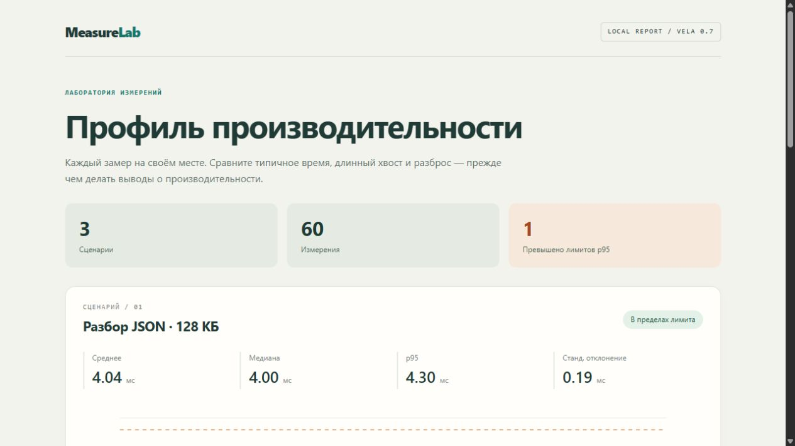

# Vela

**A self-hosted programming language with explicit effects and tools for AI agents.**

[Русский](README.ru.md) · [Language](docs/LANGUAGE.md) · [Quickstart](docs/AGENT-QUICKSTART.md) · [Roadmap](docs/ROADMAP.md) · [MIT license](LICENSE)

Vela compiles to native executables through C11. Its compiler, source bundler,
build driver and test runner are written in Vela. The language makes types,
side effects and error paths visible so that people and agents can reason about
a small piece of code from its local context.

**Vela 1.2.0** adds compact agent entry, native API discovery/project scaffolding,
checked diagnostic previews, typed CLI/JSON schemas, stable generic sorting and
traversals, Set/Cell, bounded streams and ordered parallel jobs. The three
acceptance applications use these libraries while retaining their original
functional oracles. The 1.0/1.1 API and source baseline remains in force.
See [current acceptance](docs/VALIDATION-1.2.md), [agent entry](docs/AGENT-START.md)
and [library map](docs/STDLIB-MAP-1.2.md) for measured results and platform scope.
Package names under `dist/`: `vela-1.2.0-windows-x64.zip`,
`vela-1.2.0-linux-x64-musl.tar.gz`, `vela-mcp-1.2.0.zip`,
with `SHA256SUMS-1.2.0.txt`. [Historical 1.1 acceptance](docs/VALIDATION-1.1.md).

The [stable 1.0 API contract](docs/contracts/STABLE-1.0.md),
[compatibility policy](docs/COMPATIBILITY.md) and
[migration from 0.11](docs/MIGRATING-1.0.md) remain in force. Typed async tasks,
awaitable HTTP/process operations, the shared Windows GUI library, observable
compiler caching and packaged resources are retained.

## Published 1.0.0 archives

| Package | Target |
|---|---|
| [Windows native](https://github.com/Unrea1Alex/Vela/releases/download/v1.0.0/vela-1.0.0-windows-x64.zip) | Compiler, tools, sources, recovery seed and GUI examples; Windows x64/MSVC |
| [Linux console](https://github.com/Unrea1Alex/Vela/releases/download/v1.0.0/vela-1.0.0-linux-x64-musl.tar.gz) | Static x86-64 compiler, standard modules, standalone source and C recovery seed |
| [MCP adapter](https://github.com/Unrea1Alex/Vela/releases/download/v1.0.0/vela-mcp-1.0.0.zip) | Optional Node.js 24+ integration; use the matching Windows native package |

[Release notes](https://github.com/Unrea1Alex/Vela/releases/tag/v1.0.0) ·
[SHA-256 checksums](https://github.com/Unrea1Alex/Vela/releases/download/v1.0.0/SHA256SUMS-1.0.0.txt)

Windows x64/MSVC is the full validation target. Linux x86-64/GCC/musl covers
the compiler and console programs; Windows GUI, DLL, worker/fiber and HTTP
adapters are outside that target. [Platform scope](docs/contracts/PLATFORM-SUPPORT.md).

## A small example

```text
type NodeId = distinct Int;
struct Node { id: NodeId, name: String }

fn main() -> Unit effects { state, io } {
    let nodes = list_new<Node>();
    list_push(nodes, Node(id: NodeId(1), name: "root"));
    for node in nodes {
        print(f"{node.id.value:d}: {node.name:s}");
    }
}
```

This prints `1: root`. `NodeId` is distinct from `Int`; collections require the
`state` effect even for reads, and printing requires `io`.

## Try it on Windows

Install Visual Studio Build Tools with the **Desktop development with C++**
workload and a Windows SDK. Clone the repository, then run from PowerShell:

```powershell
git clone https://github.com/Unrea1Alex/Vela.git
cd Vela
.\vela.cmd --version
.\vela.cmd check examples/pipeline.vela
.\vela.cmd run examples/pipeline.vela
.\vela.cmd build examples/factorial.vela -o bin/my-factorial.exe
.\bin\my-factorial.exe 10
```

The repository includes five verified bootstrap/tool executables in `bin/`. The command
wrappers locate MSVC automatically. Checking source, formatting and inspecting
symbols do not require a C compiler. Building and running source do. Finished
Vela programs do not require Vela, Python or Node.js to run.

To build the compiler without a Vela executable, use the standalone
[C recovery seed](bootstrap/README.md). Its source and recovery procedure are
included in the repository.

For syntax highlighting in VS Code, install the [Vela Language extension](integrations/vscode/README.md).

## What works today

- Static types, structs, enums, exhaustive matching and nominal `distinct` IDs.
- Generic functions and types, `List<T>`, `Dict<K,V>`, `Option`, `Result` and `?`.
- Explicit effects, runtime contracts and checked signed integer arithmetic.
- Float64 with explicit integer conversions, square root and fixed precision.
- Precise nonmoving GC, lexical cleanup with `scope` and `defer`.
- Typed JSON navigation and bounded byte/text builders.
- Imports, public declarations, local project dependencies and lock files.
- Standard modules for text, paths, collections, JSON, CLI, configuration, files,
  processes and testing.
- Named tests, structured diagnostics, formatting and symbol inspection.
- Native semantic queries, revision-checked edit previews and a stdio LSP service.
- Triple-quoted multiline raw strings for static text.
- Synchronous Windows x64 FFI ABI 1, with explicit native dependencies and handles.
- Opaque structures, methods, nominal interfaces, closures and callable effects.
- Typed async tasks, task groups and awaitable HTTP/process adapters on Windows.
- A shared Windows GUI module and bounded HTTP/HTTPS client and loopback server.

See the [language specification](docs/LANGUAGE.md), [standard library](docs/STDLIB.md)
and [project guide](docs/PROJECTS.md) for exact behavior and limits.

## Use Vela with an agent

The optional [MCP adapter](integrations/mcp/README.md) supplies language help,
project context, checking, formatting, semantic queries and edit previews. The accompanying
[application skill](integrations/agent/vela-app/SKILL.md) teaches an agent how to
use the current language without guessing syntax or APIs.

For a source checkout, install Node.js 24 or newer and build the adapter:

```powershell
cd integrations/mcp
npm ci
npm run build
```

Follow the [MCP setup instructions](integrations/mcp/README.md) to connect an
existing application folder to the matching toolchain. Optional build, test and
run tools become available only after the Windows LPAC/Job isolation probes pass.
An opted-in successful run can return generated file IDs for explicit retrieval.
The native compiler and ordinary programs have no Node.js or MCP dependency.

## An application: MeasureLab

[MeasureLab](apps/measurelab/README.md) reads JSON measurements, computes mean,
median, p95 and standard deviation, and writes an offline HTML/SVG report.
Its data model, validation, statistics and rendering use Vela's numeric, JSON and text APIs.



The screenshot uses synthetic data, not compiler benchmarks. Build and run the
application from the repository root:

```powershell
.\apps\measurelab\build.ps1
.\apps\measurelab\run-demo.cmd
```

The repository also contains [TimeLog](apps/timelog/README.md), a TSV-to-HTML
report application, and smaller [language examples](examples/).

[SourceLens](apps/source-lens/README.md) turns semantic query JSON into a
searchable offline HTML report of modules, functions, calls and effects.
Its acceptance covers raw templates, CLI/LSP refactoring and MCP output export.

[FieldDesk](apps/fielddesk/README.md) exercises Vela with calibrated measurements,
an offline report, native editor, replaceable services, record/replay and callbacks.
Its asynchronous HTTPS loading uses the standard HTTP client with cancellation.

[PulseDeck](apps/pulse-deck/README.md) uses task groups and awaitable HTTP/HTTPS
checks, typed async delays, a native window, cancellation, JSON reports and a
local Vela demonstration server. Run `.\vela.cmd run apps/pulse-deck/build.vela`,
then `.\apps\pulse-deck\bin\pulse-deck.exe` for an offline demo.

## Build and verify the language

```powershell
.\vela-dev.cmd verify
```

This builds three compiler generations, compares emitted C byte for byte,
checks the bundler fixed point and runs the native fixture/driver suite.
See the [1.0 release validation](docs/VALIDATION-1.0.md), [tooling guide](docs/TOOLING.md)
and the [architecture](docs/ARCHITECTURE.md).

Edit the authored files listed in `selfhost/sources.list`; regenerate
`selfhost/compiler.vela` using `.\vela-dev.cmd bundle`. Contributor rules are in
[AGENTS.md](AGENTS.md). Bug reports should include the compiler version, a small
reproducer, the command used, expected behavior and actual diagnostics.

## Current limits and next steps

Contracts run at runtime. GC keeps reachable data and explicit close releases
external resources. Closures and typed async tasks are implemented. The trusted
cache reuses unchanged graphs; changed graphs still receive full semantic checking.
HTTP uses supervised curl processes on Windows and can be awaited through
`async_io` inside a task-group scope. It does not pool connections. The shared
GUI forms API is Windows-only; portable widgets remain future work.

The [roadmap](docs/ROADMAP.md) records the next development steps and release gates.
Use the compiler, documentation and MCP manifest from the same checkout.
The compiler, bootstrap and verification use native Vela tools. The historical
Python 0.2 implementation has been removed from the current source tree; it remains
in Git history. The `vela/` directory contains the active builtin catalog and C runtime/FFI headers.

Vela is available under the [MIT license](LICENSE).
