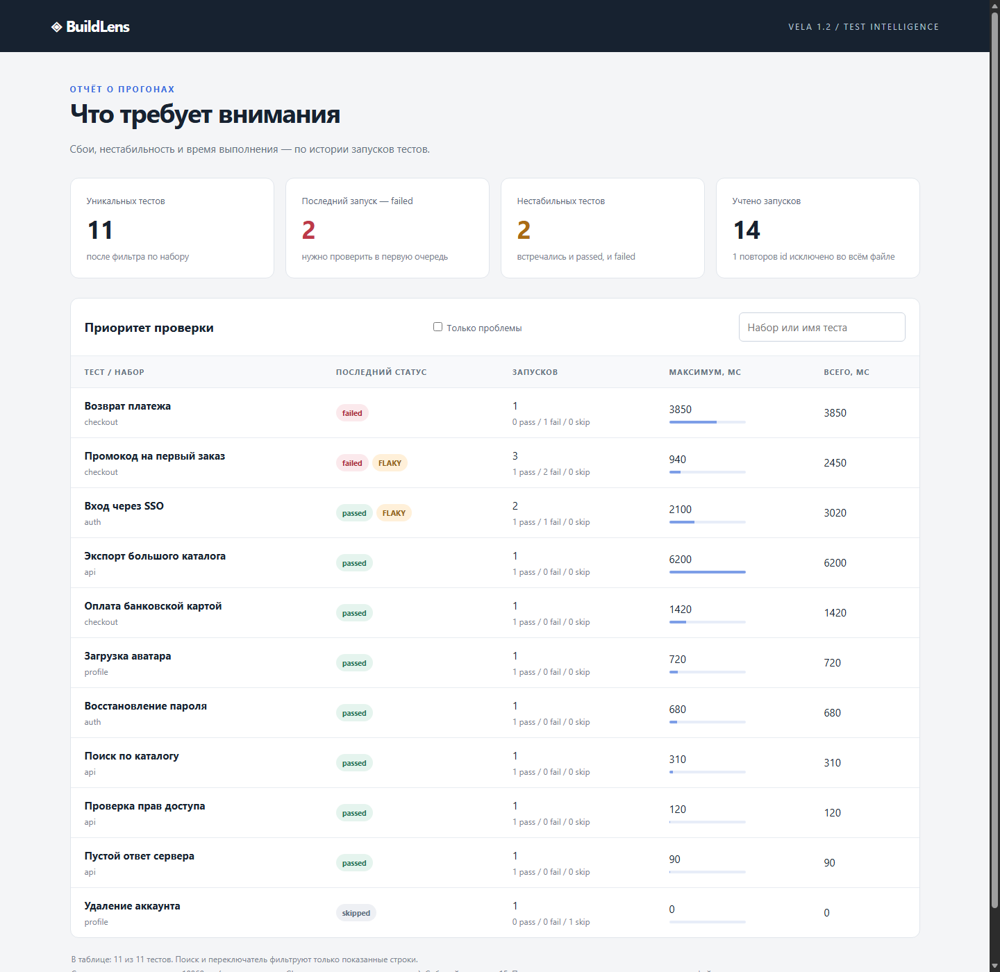

# BuildLens 0.1.0

Анализатор результатов тестов на **Vela 1.2.0**. Читает JSONL с повторными
запусками, находит последние сбои и нестабильные тесты, считает длительность.
Создаёт JSON для CI или автономный HTML с поиском и фильтром проблем.



## Запуск готовой программы

Из каталога распакованного Windows-архива:

```powershell
.\buildlens.exe demo.jsonl --format html --output report.html
Start-Process .\report.html
.\buildlens.exe demo.jsonl --suite auth --top 10
.\buildlens.exe demo.jsonl --fail-on-problem --output result.json
.\buildlens.exe --help
```

Последняя команда анализа возвращает **1**, если в выборке есть failed/flaky;
отчёт при этом уже записан. Ошибки входа/аргументов/записи возвращают **2**.
Без `--output` отчёт выводится в stdout. Успех и `--help` возвращают **0**.
Программа не требует установленного Vela, Node.js, сервера или интернет-соединения.
HTML использует небольшой встроенный JavaScript только для фильтрации таблицы.

Минимальная строка входа:

```json
{"id":"run-1","suite":"auth","name":"login","status":"passed","duration_ms":120}
```

Повторные запуски одного теста получают разные id. Повтор уже известного id
валидируется, но не учитывается повторно. Flaky означает, что в этой выборке
у теста встречались и passed, и failed. Последний результат определяется
порядком строк файла. Это не прогноз вероятности сбоя.

Все правила, лимиты и порядок сортировки — в [контракте](CONTRACT.md).
В HTML показаны первые `--top` тестов (по умолчанию 20, максимум 1000).
Сводка относится ко всей выбранной группе, поиск — к показанным строкам.
Сумма duration_ms не равна времени CI при параллельном запуске тестов.

## Сборка и проверки из корня репозитория Vela

```powershell
New-Item -ItemType Directory -Force apps/build-lens/bin | Out-Null
.\vela.cmd check apps/build-lens/vela.project
.\vela.cmd build apps/build-lens/vela.project -o apps/build-lens/bin/buildlens.exe
.\vela.cmd test apps/build-lens/vela.project --json
pwsh -NoProfile -File apps/build-lens/verify.ps1
node apps/build-lens/verify-html.mjs
```

Последняя, отдельная проверка требует Node.js 22+ и установленный Edge.
Другой Chromium можно задать через `BUILDLENS_BROWSER`. Это инструменты приёмки,
а не зависимости сборки или работы приложения. `verify.ps1` требует PowerShell 7.
CLI oracle использует собственные буквальные ожидаемые результаты.

Фактически проверено на Windows x64:

- native check/build/fmt и **10/10** именованных тестов;
- **56/56** CLI-проверок: literal сводка и порядок, retries/dedup, фильтры,
  коды выхода, ошибки JSON/UTF-8, лимиты, BOM/CRLF/Unicode, escaping,
  сохранение прежнего отчёта и защита входа, включая hardlink;
- **10/10** проверок HTML в Edge: фильтрация, поиск, пустое состояние,
  desktop 1440×1400 и mobile 390×844; скриншоты просмотрены;
- 10000 событий → 100 тестов, 100000 мс суммарно; время конкретного прогона
  сохранено в [validation.json](validation.json). Это один замер, не бенчмарк языка.

[CLI evidence](validation.json), [браузерная приёмка](validation-html.json),
[native tests](validation-native.json), [готовый HTML](demo-report.html),
[готовый JSON](demo-report.json). ZIP дополнительно распакован в путь с Unicode
и пробелами; executable проверен с PATH, ограниченным Windows System32,
по буквальной сводке demo. Инвентарь файлов архива проверен по SHA-256;
результат упаковки сохраняется в `validation-package.json` рядом с исходниками.
Linux в этой прикладной работе не проверялся. Общий compiler verify повторно
не запускался: изменено только приложение и его документация, семантика языка,
runtime и std сохранены. Этап 1.3.1 этим приложением не выполняется.

## Что использовано из 1.2

| Возможность | Применение |
| --- | --- |
| `vela init` | Создание проекта с manifest и named test |
| `cli_schema` | Аргументы, диапазоны, справка, отклонение неизвестных флагов |
| `json_decode` | Типизированная схема Event, строгие поля и диапазон duration_ms |
| `io` + `stream_lines` | Чтение блоками с лимитами, позиции ошибок, закрытие ресурса |
| `Set<String>` | Устранение повторных событий |
| `algorithms::fold/sort/map` | Сводка, стабильная сортировка записей, JSON-строки |
| `result_ops::and_then` | Последовательность структурной и предметной валидации |

В приложении 483 непустые строки Vela в четырёх модулях, отдельно тесты.
CSS/HTML также формируются этими модулями. Исторические примеры не изменены.

## Впечатления от разработки

Сильнее всего помогли `json_decode` и `algorithms`: схема возвращает готовый Event,
а сортировка произвольных записей задаётся компаратором. `cli_schema` сразу даёт
диапазоны и справку. Set и потоковый Reader позволяют выразить предметную задачу
через стандартные модули, без вспомогательных реализаций контейнеров и чтения файла.

Код всё ещё многословен на границах ошибок: getter аргумента, map_error,
Result, закрытие Reader. Для HTML остаётся ручная склейка строк. В тестах
понадобился свой небольшой `must`, завершающий тест при неожиданном Err.
Удобный стандартный test-helper и более компактная работа с CLI-схемой были бы
полезными дополнениями. Это предложения, не требования уже принятого релиза.

Первый проход не был без ошибок: я ошибочно использовал отсутствующий postfix `!`,
зарезервированное имя `result` и не связал возвращаемый Bool. Компилятор эти ошибки
отклонил; исправления потребовались в приложении и тестах. Отдельная проверка
модуля без main также ожидаемо получила E207. Исправлений компилятора не было.
Этот опыт показывает удобство конкретных API, но не доказывает превосходство
языка и не заменяет независимый VelaBench.

## Учёт токенов

[token-usage.json](token-usage.json) содержит исходные накопительные счётчики
провайдера до запроса и после работы, их разность и точное время среза.
`measure-tokens.ps1` воспроизводит расчёт для переданного собственного session JSONL.
В расход входят чтение документации, реализация, исправления, тесты, упаковка и
этот отчёт; предыдущая разработка Vela 1.2 исключена. Cached input показывается
отдельно от нового input. Reasoning — часть output, повторно не прибавляется.
Последний ответ и работа после указанного среза не входят в измерение.
Большой cached input отражает повторную передачу истории этого длинного чата.
Результат нельзя напрямую сравнивать с запуском в новом коротком чате.
